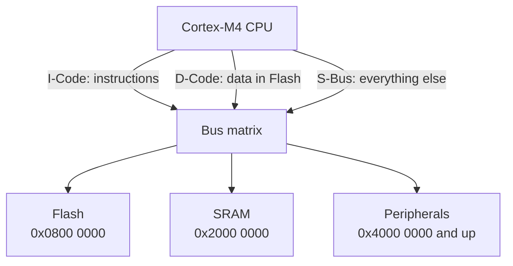
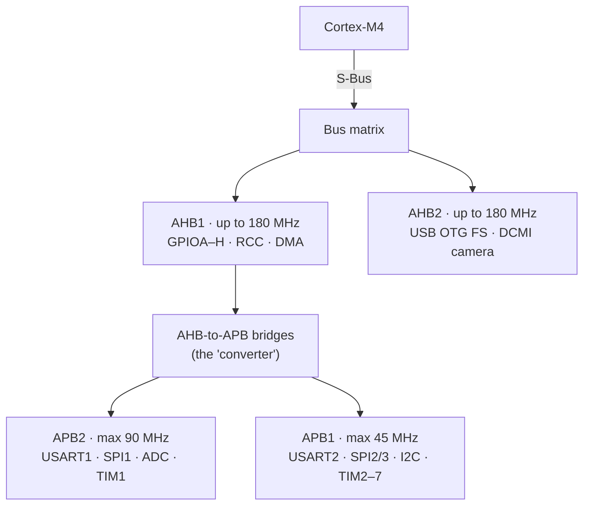
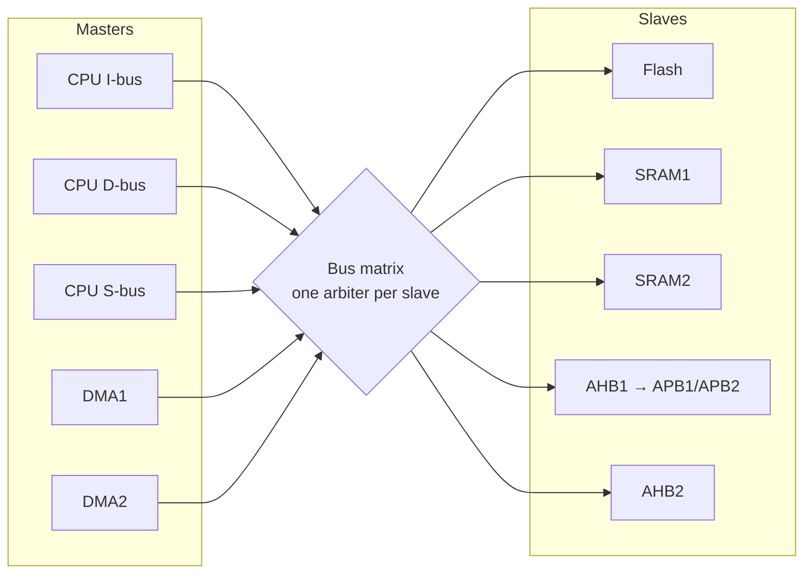

# 2026-11-02 · MCU Bus Interfaces & Bus Matrix

**Board:** NUCLEO-F446RE (STM32F446RET6 · Cortex-M4F · 180 MHz)
**Course:** FastBit MCU1 → *MCU Bus Interfaces* (Explanation Parts 1–3 · Understanding MCU Bus Matrix · Test your understanding)
**Docs used:** RM0390 (F446 reference manual) · STM32F446xC/E datasheet · UM1724 (Nucleo-64 board manual) · AN4031 (ST app note: DMA controller and bus matrix)

> The instructor's screens use an **STM32F407 Discovery** board. Everything here is written for **my F446**.
> Where the two chips differ, it says so.

| | Instructor's F407 | My F446 |
|---|---|---|
| Max CPU clock (HCLK) | 168 MHz | **180 MHz** |
| APB1 / APB2 max | 42 / 84 MHz | **45 / 90 MHz** |
| Reference manual | RM0090 | **RM0390** |
| Extra RAM | 64 KB CCM RAM | none |
| Ethernet | yes | no |

---

## Topics in this log

- [The three CPU buses: I-Code, D-Code, S-Bus](#the-three-cpu-buses-i-code-d-code-s-bus)
- [The address decides the bus](#the-address-decides-the-bus)
- [F446 memory map: the addresses that matter](#f446-memory-map-the-addresses-that-matter)
- [AHB vs APB: highway and city roads](#ahb-vs-apb-highway-and-city-roads)
- [Why the bus matters in my code](#why-the-bus-matters-in-my-code)
- [Instructions from SRAM over I-Code? (memory remap)](#instructions-from-sram-over-i-code-memory-remap)
- [Bus matrix: masters, slaves, traffic lights](#bus-matrix-masters-slaves-traffic-lights)
- [Reading the bus-matrix figure (the dots)](#reading-the-bus-matrix-figure-the-dots)
- [I-Bus vs I-Code, D-Bus vs D-Code](#i-bus-vs-i-code-d-bus-vs-d-code)
- [Bus width: 32 bits](#bus-width-32-bits)
- [FastBit quiz: all 15 questions](#fastbit-quiz-all-15-questions)
- [Documents for my board](#documents-for-my-board)
- [Common mistakes](#common-mistakes)
- [Revision quiz](#revision-quiz)
- [Doubts I asked today](#doubts-i-asked-today)
- [Handoff](#handoff)

---

## The three CPU buses: I-Code, D-Code, S-Bus

**What it is**
→ The Cortex-M4 has **3 separate buses** (roads) going out of the CPU
→ Each road carries a different kind of traffic

**Why it exists**
→ The CPU can **fetch the next instruction and read data at the same time**
→ Nothing waits in one queue → code runs faster

**Analogy: a restaurant kitchen with 3 doors**

| Bus | Door | Carries |
|---|---|---|
| **I-Code** | Recipe door | Instructions (from Flash) |
| **D-Code** | Pantry door | Data stored next to the code in Flash: constants, lookup tables |
| **S-Bus** (system bus) | Main gate | Everything else: SRAM and all peripherals (GPIO, UART, SPI…) |



**Real example**

```c
const int table[4] = {1, 2, 3, 4};  // const → stored in Flash
int x = table[2];                    // reading data from Flash  → D-Code
GPIOA->ODR = 1;                      // writing to a peripheral  → S-Bus → AHB1
// the instructions for these lines themselves are fetched       → I-Code
```

**My other board (F030R8, Cortex-M0)**
→ The M0 has **one single bus** for everything, with no I/D/S split
→ One reason the M0 is simpler and slower

---

## The address decides the bus

The instructor's notes, as one table:

| What | Where it lives | Bus used |
|---|---|---|
| Instruction | `0x0000_0000` – `0x1FFF_FFFC` | **I-Code** |
| Instruction | anywhere else | **S-Bus** |
| Data | `0x0000_0000` – `0x1FFF_FFFF` | **D-Code** |
| Data | anywhere else | **S-Bus** |

**The rule to remember**
→ The CPU picks the bus by the **address**, not by which physical memory it is
→ `0x0000_0000 – 0x1FFF_FFFF` is the **code region** (Flash lives here) → I-Code / D-Code
→ Everything above it (SRAM, peripherals) → S-Bus

**On my F446**

| Thing | Address | Inside the code region? | Bus |
|---|---|---|---|
| Flash | `0x0800_0000` | ✅ yes | I-Code (instructions) · D-Code (data) |
| SRAM | `0x2000_0000` | ❌ no | S-Bus |
| Peripherals | `0x4000_0000` and up | ❌ no | S-Bus |

### Doubt: why does one range end in FC and the other in FF?

→ An instruction fetch grabs **4 bytes at a time** (one 32-bit word)
→ So the last fetch must **start** at `…FC`, and it covers `FC FD FE FF`
→ Data can be read **one byte at a time**, so its range goes right up to `…FF`
→ It's the same region: one counts in 4-byte steps, the other in 1-byte steps

```
 ... 1FFF_FFFC │ FC │ FD │ FE │ FF │
                └─ one instruction fetch = 4 bytes ─┘
 a data read can stop at any single byte, so its range ends at FF
```

**Why it matters**
→ Code in Flash: I-Code and D-Code work **in parallel** → fast ✅
→ Code copied into SRAM and run there: instructions and data **share the S-Bus** → slower ⚠️

---

## F446 memory map: the addresses that matter

| Start address | Region | What's there (F446) | CPU bus |
|---|---|---|---|
| `0xE000_0000` | Cortex-M4 internal | NVIC, SysTick | CPU-internal |
| `0x5000_0000` | AHB2 | USB OTG FS, DCMI (camera) | S-Bus |
| `0x4002_0000` | AHB1 | GPIOA `0x4002_0000` … RCC `0x4002_3800`, DMA | S-Bus |
| `0x4001_0000` | APB2 | USART1, SPI1, ADC1 `0x4001_2000`, TIM1 | S-Bus |
| `0x4000_0000` | APB1 | USART2, SPI2/3, I2C1–3, TIM2–7, CAN1/2 | S-Bus |
| `0x2000_0000` | SRAM | 128 KB (SRAM1 112 KB + SRAM2 16 KB) | S-Bus |
| `0x0800_0000` | Flash | 512 KB, where my program lives | I-Code / D-Code |
| `0x0000_0000` | Alias | Flash also appears here (by default) | I-Code / D-Code |

> ⚠️ GPIOA, RCC and ADC1 addresses match the instructor's screens (they are the same on F4 chips).
> The other rows come from F4-family knowledge. Confirm them in **RM0390 → memory map table** before relying on them.

---

## AHB vs APB: highway and city roads

What the instructor said, in short:
→ The S-Bus goes through the bus matrix to **AHB1 / AHB2**, the fast buses
→ A **converter** (AHB-to-APB bridge) turns AHB into **APB1 / APB2**, the slower buses
→ Most peripherals hang on APB, so they're called **slow peripherals**
→ A few hang on AHB, the **high-speed peripherals**. **GPIOs are on AHB1.**

**My first summary had one mistake**
→ GPIOA and SPI are **not** on the same bus
→ GPIO = AHB1 (fast) · SPI, USART, I2C, timers, ADC = APB (slow)



**Analogy**
→ AHB = highway, APB = city roads
→ The bridge = a toll gate that slows traffic down to city speed

**Instructor's camera example**
→ A camera dumps a huge amount of data every frame
→ On a 45 MHz road it would choke, so the camera interface (DCMI) sits on **AHB2**

| Bus | Max clock (F446) | Kind | Lives there |
|---|---|---|---|
| AHB1 | 180 MHz | fast | GPIOA–H, RCC, DMA |
| AHB2 | 180 MHz | fast | USB OTG FS, DCMI |
| APB2 | 90 MHz | slow | USART1, SPI1, ADC, TIM1 |
| APB1 | 45 MHz | slowest | USART2 (my Nucleo's USB serial), SPI2/3, I2C, TIM2–7 |

---

## Why the bus matters in my code

**1. The clock-enable register depends on the bus**

Before touching any peripheral, you must **switch on its clock** in RCC. Which register you use depends on the bus it lives on:

```c
RCC->AHB1ENR |= (1 << 0);   // GPIOA clock ON   (GPIOA is on AHB1)
RCC->APB2ENR |= (1 << 12);  // SPI1  clock ON   (SPI1 is on APB2)
RCC->APB1ENR |= (1 << 17);  // USART2 clock ON  (USART2 is on APB1)
```

→ Wrong register = the peripheral stays dead, and your code "does nothing"
→ **No error message.** This is the #1 beginner bug in GPIO drivers.

**2. Speed math uses the bus clock**
→ UART baud rate and timer timing use **that bus's clock** (PCLK1 or PCLK2)
→ Not the 180 MHz CPU clock

> ⚠️ The bit numbers (0, 12, 17) come from F4 knowledge. Check them in **RM0390 → RCC registers** before using them in P1.

---

## Instructions from SRAM over I-Code? (memory remap)

FastBit quiz Q2: *"Processor can fetch instructions from SRAM over the I-Code bus. True/False?"*

→ **Default answer: False.** SRAM sits at `0x2000_0000`, outside the code region, so its instructions come over the **S-Bus**
→ **Advanced: it can be done.** The instructor said "for the time being, false"

**The key idea that unlocks it**
→ The CPU picks the bus by **address**, not by the physical memory
→ Address `0x0000_0000 – 0x1FFF_FFFF` → I-Code. That's all.

**The trick: memory remapping**
→ The F446 can make SRAM1 **also** appear at address `0x0000_0000`
→ Same physical SRAM, now visible at two addresses (an "alias")
→ Fetch from the `0x0` alias → it's in the code region → **I-Code** ✅

```
Normal:                          After remap:
0x2000_0000  SRAM  ◄── S-Bus     0x2000_0000  SRAM  ◄── S-Bus
0x0800_0000  Flash               0x0800_0000  Flash
0x0000_0000  Flash (alias)       0x0000_0000  SRAM (alias) ◄── I-Code
```

**Analogy**
→ One house with two gates
→ Side gate (`0x2000_0000`) = slow road · main gate (`0x0`) = express road

**Two ways to remap**
1. **Boot pins** (BOOT0 / BOOT1): decide what sits at `0x0` at power-up
2. **SYSCFG_MEMRMP register**: switch it in software later

> ⚠️ Names from F4 knowledge. Confirm in **RM0390 → SYSCFG chapter** and the **boot configuration** section.

**When is this used?**
→ Bootloaders, or running a speed-critical function from RAM
→ **Not needed for P1**

---

## Bus matrix: masters, slaves, traffic lights

The instructor opened **AN4031** ("Using the STM32F2 and STM32F4 DMA controller"), Section 2: *System performance considerations*.

**Masters vs slaves**

| Masters: can **start** a read/write | Slaves: only **respond** |
|---|---|
| CPU I-bus · CPU D-bus · CPU S-bus | Flash (I-Code port) · Flash (D-Code port) |
| DMA1 memory port · DMA2 memory port · DMA2 peripheral port | SRAM1 · SRAM2 |
| Ethernet DMA · USB HS DMA *(F407 only)* | AHB1 (incl. APB bridges) · AHB2 · FSMC |

**Analogy**
→ Masters = cars, slaves = destinations
→ The bus matrix = a junction with **one traffic light per destination**



**Rule 1: different destinations → everyone goes at once ✅**
→ The CPU fetches from Flash while DMA writes to SRAM1, both in parallel

**Rule 2: same destination → take turns (round-robin)**
→ The CPU and DMA1 both want SRAM1 → one waits one turn (AN4031 Fig 8)
→ Each master gets **1 transfer** per turn
→ More masters waiting = longer wait. That wait is the **latency** (AN4031 Fig 9)

```
time →  | CPU | DMA1 | DMA2 | USB | ETH | CPU | DMA1 |
               └── DMA1 waits for every other master's turn ──┘
```

**Fun fact from AN4031**
→ The CPU can hold the bus for a few cycles in a row (interrupt entry, multi-register load/store)
→ That's why a DMA transfer can sometimes wait longer than one turn

> ⚠️ AN4031's figure is for the **F40x/F41x** (168 MHz, CCM RAM, Ethernet). The F446 isn't in its product list.
> For my exact chip, use **RM0390 → system architecture → bus matrix figure**.

---

## Reading the bus-matrix figure (the dots)

The figure is a **grid**:
→ **Vertical lines** = a master's bus (D-bus, I-bus, S-bus, DMA…)
→ **Horizontal lines** = a slave (AHB1, SRAM1, Flash…)
→ **A dot at a crossing** = "this master **can** reach this slave"
→ **No dot** = no road there at all

**The CPU's 3 buses, dot by dot (F407 figure)**

| Slave ↓ / CPU bus → | D-bus | I-bus | S-bus |
|---|---|---|---|
| AHB1 (GPIO, APB bridges) | – | – | ✅ |
| AHB2 (USB FS) | – | – | ✅ |
| SRAM1 | ✅ | – | ✅ |
| SRAM2 | ✅ | – | ✅ |
| FSMC (external memory) | ✅ | ✅ | ✅ |
| Flash | ✅ D-Code | ✅ I-Code | – |
| **Total** | **4** | **2** | **5** |

→ That matches the instructor: the D-bus reaches 4 slaves, the I-bus reaches 2

**What to take away**
→ The S-bus has **no dot on Flash**, so quiz Q1 is proven straight from the picture
→ Only the S-bus reaches **AHB1**, so every GPIO write in P1 travels **CPU → S-bus → bus matrix → AHB1**
→ The instructor's key line: *"this may not be true in another microcontroller"*. The dots are fixed **per chip**.

**Analogy**
→ A metro map: each line (master) stops only at certain stations (slaves)
→ A dot is a station on that line

> 🔲 Open task: find the **F446** bus-matrix figure in RM0390 and count the D-bus and I-bus dots. Same as the F407?

---

## I-Bus vs I-Code, D-Bus vs D-Code

**Short answer: same road, different end**
→ **I-Bus** = the road **leaving the CPU** (master side)
→ **I-Code** = where that road **enters Flash** (Flash's instruction door, slave side)
→ Same pattern for **D-Bus** (leaving the CPU) and **D-Code** (Flash's data door)

```
  CPU
   │ I-Bus ──┐                    ┌── I-Code ──► FLASH (instruction door)
   │         ├──► BUS MATRIX ─────┤
   │ D-Bus ──┘          │         └── D-Code ──► FLASH (data door)
   │                    └────────────────────────► FSMC, SRAM… (other slaves)
```

**Why there are two names**
→ The I-Bus can go to **more than one place** (Flash **and** FSMC, as the dots showed)
→ "I-Code" names only the **Flash end** of it
→ Same for D: the D-Bus reaches 4 slaves; D-Code is just its Flash door

**Analogy**
→ I-Bus = your colony's road out to the main street
→ I-Code = the gate of one shop (Flash) on that road. The same road also reaches other shops.

**In practice**
→ The ARM manual and most people use I-Code ≈ I-Bus loosely
→ The difference only shows in ST's bus-matrix picture: **Bus = master side, Code = Flash side**

---

## Bus width: 32 bits

Question (STM32F407 Discovery): *"the width of the system bus is ___"* → **32 bits** ✅

→ The Cortex-M4 is a **32-bit** processor
→ All 3 buses (I, D, S) are **32-bit AHB-Lite**, so one transfer moves up to 4 bytes
→ My F446 has the same core → same answer

**Link to what I learned above**
→ 32 bits = 4 bytes → that's why instruction fetches move in 4-byte steps and the I-Code range ends at `…FC`

```
one bus transfer = 32 bits
| byte3 | byte2 | byte1 | byte0 |
```

**Common trap**
→ A 32-bit bus doesn't mean every transfer is 32 bits
→ It can also move 8 bits (`uint8_t`) or 16 bits in one transfer. 32 is the **maximum**.

---

## FastBit quiz: all 15 questions

*Reference: STM32F446RE. Try each one before opening the answers.*

<details>
<summary>Show all answers</summary>

| # | Question | Answer | Why |
|---|---|---|---|
| 1 | Is the System Bus **not** connected to Flash memory? | **True** | Flash is reached only over I-Code and D-Code (no S-bus dot on Flash) |
| 2 | Can the processor fetch instructions from SRAM over I-Code? | **False** (by default) | SRAM at `0x2000_0000` is outside the code region → S-Bus. Advanced: remap SRAM to `0x0000_0000`, then the alias is fetched over I-Code |
| 3 | Can the System Bus run up to 180 MHz? | **True** | The S-Bus runs at HCLK, max 180 MHz |
| 4 | Are SRAMs connected to the System Bus? | **True** | SRAM is outside the code region → S-Bus |
| 5 | Can APB1 run up to 180 MHz? | **False** | APB1 max = 45 MHz |
| 6 | A peripheral must run above 95 MHz. Can it go on APB2? | **No** | APB2 max = 90 MHz |
| 7 | Can instructions and data be fetched from SRAM at the same time? | **False** | Both share the one S-Bus, so they take turns |
| 8 | Can instructions and data be fetched from Flash at the same time? | **True** | I-Code and D-Code are separate buses |
| 9 | Max HCLK? | **180 MHz** | AHB / CPU clock |
| 10 | Max P1CLK (APB1)? | **45 MHz** | |
| 11 | Max P2CLK (APB2)? | **90 MHz** | |
| 12 | Do GPIOs and the processor talk over AHB1? | **True** | GPIO ports hang on AHB1 |
| 13 | Do USB OTG and the processor talk over AHB2? | **True** | USB OTG FS (and the DCMI camera) are on AHB2 |
| 14 | Can USB OTG and GPIOs talk to the processor simultaneously? | **False** | Both are reached through the CPU's **single S-Bus**, so one at a time |
| 15 | Can the processor talk to Flash and SRAM simultaneously? | **True** | Dedicated buses: I/D-Code → Flash, S-Bus → SRAM |

</details>

**The one to really get: Q14 vs Q15**

```
Q15 ✅  Flash ◄── I/D-Code ──┐
                             CPU      two separate roads → parallel
        SRAM  ◄── S-Bus ─────┘

Q14 ❌  USB  (AHB2) ──┐
                      ├── S-Bus ── CPU   one road → take turns
        GPIO (AHB1) ──┘
```

→ "Simultaneous" only happens when the two targets sit on **different CPU buses**

---

## Documents for my board

| Document | Code | Open it for | Link |
|---|---|---|---|
| Reference manual | **RM0390** | Registers, memory map, buses, RCC, GPIO, EXTI | [ST product page](https://www.st.com/en/microcontrollers-microprocessors/stm32f446re.html) → Documentation tab |
| Datasheet | **STM32F446xC/E** (DS10693) | Pinout, alternate-function table, 5 V-tolerant pins, electrical limits, max clocks | [stm32f446re.pdf](https://st.com/resource/en/datasheet/stm32f446re.pdf) |
| Board manual | **UM1724** (Nucleo-64) | What's wired on the board: LED LD2 = PA5 (D13), button B1 = PC13, ST-LINK, solder bridges, clock options | [UM1724](https://www.st.com/resource/en/user_manual/DM00105823-.pdf) |
| App note | **AN4031** | Bus matrix, masters/slaves, DMA | PDF from the course |

**Which one to open, when**

| Question | Open |
|---|---|
| Which register or bit? | RM0390 |
| Which pin, what voltage? | Datasheet |
| What's wired on the board? | UM1724 |

---

## Common mistakes

→ Thinking the S-Bus is "slow and bad". It's just the general road, and peripherals **must** use it.
→ Mixing up D-Code and S-Bus: **D-Code = data from Flash**, S-Bus = data from SRAM and peripherals
→ Forgetting that code run from SRAM is fetched over the S-Bus. It loses the parallel fetch and runs slower.
→ Enabling a peripheral clock in the **wrong RCC register** (AHB1ENR vs APB1ENR vs APB2ENR). The peripheral stays dead, with **no error**.
→ Using 180 MHz in baud or timer math. Use **that bus's clock** (PCLK1 / PCLK2).
→ Copying the instructor's F407 numbers (168 / 42 / 84 MHz) onto the F446 (**180 / 45 / 90 MHz**)

---

## Revision quiz

Answer from memory first, then open.

1. Running `main()` from Flash: which bus fetches its instructions?
2. Reading a global `int count` (it lives in SRAM): which bus?
3. Reading `const float pi = 3.14f;` (it lives in Flash): which bus?
4. Toggling an LED on GPIOA: what path does the write take?
5. Which RCC register enables the GPIOC clock?
6. USART2 lives on which bus, and what's its max clock on the F446?
7. Why can the M4 beat the M0 at the same clock speed? Give one bus reason.
8. The I-Bus reaches which 2 slaves (F407 figure)? Which one is the "I-Code" end?
9. Why is "instructions and data fetched simultaneously from SRAM" false?

<details>
<summary>Answers</summary>

1. **I-Code**
2. **S-Bus**
3. **D-Code**
4. CPU → **S-Bus** → bus matrix → **AHB1** → GPIOA
5. **RCC_AHB1ENR** (GPIO ports are on AHB1; GPIOC = bit 2, confirm in RM0390)
6. **APB1**, max **45 MHz**
7. Separate instruction and data buses work **in parallel**; the M0 has one bus for everything
8. **Flash** (that's the I-Code end) and **FSMC**
9. SRAM has only **one road** to the CPU (the S-Bus), so instructions and data take turns

</details>

---

## Doubts I asked today

1. Why does the I-Code range end at `…FC` but the D-Code range at `…FF`? → [The address decides the bus](#the-address-decides-the-bus)
2. What did the instructor mean by "the system bus meets a converter → APB1/APB2"? → [AHB vs APB](#ahb-vs-apb-highway-and-city-roads)
3. Where are the datasheet and reference manual for my NUCLEO-F446RE? → [Documents for my board](#documents-for-my-board)
4. "SRAM over I-Code is false for now, but possible": what does that mean? → [Memory remap](#instructions-from-sram-over-i-code-memory-remap)
5. Store all the quiz questions with answers → [FastBit quiz](#fastbit-quiz-all-15-questions)
6. What is AN4031, and why did the instructor open it? → [Bus matrix](#bus-matrix-masters-slaves-traffic-lights)
7. How do I read the bus-matrix figure the instructor drew on? → [Reading the dots](#reading-the-bus-matrix-figure-the-dots)
8. I-Bus vs I-Code, D-Bus vs D-Code: what's the difference? → [I-Bus vs I-Code](#i-bus-vs-i-code-d-bus-vs-d-code)
9. The system bus width on the STM32F407 Discovery: 32? → [Bus width](#bus-width-32-bits)

---

## Handoff

- **Done:** FastBit *MCU Bus Interfaces* Parts 1–3, bus matrix, the 15-question quiz; collected RM0390 / datasheet / UM1724; read AN4031 Fig 7–9
- **Dragged or flowed:** not recorded
- **Bug of the day:** none (no code today)
- **Tomorrow's first task:** FastBit → *Understanding MCU Clocks*
- **Open question:** does the F446's bus-matrix figure (RM0390) have the same CPU dots as the F407's?
